# AWS Dev Environment with Terraform

Infrastructure as Code project that provisions a complete development environment on AWS using Terraform: a custom VPC, a public subnet with internet access, a private subnet that reaches the internet through a NAT gateway, a security group, an SSH key pair, and an Ubuntu 24.04 EC2 instance that installs Docker on first boot, runs an nginx container, and adds itself to my local SSH config for one-command access.

I built this to rebuild, as code, the VPC and EC2 patterns I first created by hand in the AWS console and CLI (see my [AWS Beginner Roadmap](https://github.com/Bla-vk/AWS-Beginner-Roadmap)). One `terraform apply` now creates in about a minute what took many manual steps before.

**Result:** the whole environment builds with one `terraform apply`. The public server is reachable over SSH, runs Docker and serves an nginx page, and a test server in the private subnet reaches the internet only through the NAT gateway (its outbound IP matches the NAT's Elastic IP). Everything is then removed cleanly with `terraform destroy`.

---

## Table of Contents

- [Architecture](#architecture)
- [What It Builds](#what-it-builds)
- [Project Structure](#project-structure)
- [How It Works](#how-it-works)
- [Prerequisites](#prerequisites)
- [Usage](#usage)
- [Results](#results)
- [Troubleshooting](#troubleshooting)
- [Security Notes](#security-notes)
- [Skills Demonstrated](#skills-demonstrated)
- [What I Learned](#what-i-learned)
- [Next Steps](#next-steps)

---

## Architecture

```
                    Internet
                       |
              [ Internet Gateway ]  dev-igw
                       |
   +------------ VPC dev (10.100.0.0/16) -------------+
   |                                                  |
   |  Public route table: 0.0.0.0/0 -> IGW            |
   |   [ Public subnet 10.100.1.0/24 ]  eu-west-2a    |
   |     [ EC2 dev-node ]  <- dev-sg                  |
   |     Ubuntu 24.04, t3.micro, Docker, nginx        |
   |     [ NAT gateway dev-nat + Elastic IP ]         |
   |                    ^                             |
   |  Private route table: 0.0.0.0/0 -> NAT           |
   |   [ Private subnet 10.100.2.0/24 ]               |
   |     no public IPs, outbound through the NAT      |
   +--------------------------------------------------+
```

---

## What It Builds

| Resource                            | Name                      | Purpose                                                                                                                                             |
| ----------------------------------- | ------------------------- | --------------------------------------------------------------------------------------------------------------------------------------------------- |
| VPC                                 | `dev`                     | Isolated network, CIDR `10.100.0.0/16`, DNS support and hostnames enabled                                                                           |
| Public subnet                       | `dev-public-subnet`       | `10.100.1.0/24` in `eu-west-2a`, auto-assigns public IPs                                                                                            |
| Internet Gateway                    | `dev-igw`                 | Gives the VPC a path to the internet                                                                                                                |
| Route table                         | `dev-public-route-table`  | Holds the public routing rules                                                                                                                      |
| Route                               | `0.0.0.0/0`               | Sends internet-bound traffic to the Internet Gateway                                                                                                |
| Route table association             | n/a                       | Attaches the route table to the public subnet                                                                                                       |
| Security group                      | `dev-sg`                  | Allows SSH (port 22) and HTTP (port 80) only from my current public IP, looked up automatically on each run (see [Security Notes](#security-notes)) |
| Private subnet                      | `dev-private-subnet`      | `10.100.2.0/24`, no public IPs, outbound access only through the NAT gateway                                                                        |
| Elastic IP                          | n/a                       | Fixed public address used by the NAT gateway                                                                                                        |
| NAT gateway                         | `dev-nat`                 | Lets private resources reach the internet without being reachable from it. Billed hourly, so it is applied for testing and destroyed the same day   |
| Private route table and association | `dev-private-route-table` | Sends `0.0.0.0/0` from the private subnet to the NAT gateway                                                                                        |
| Key pair                            | `main-key`                | Registers my local public SSH key with AWS                                                                                                          |
| EC2 instance                        | `dev-node`                | `t3.micro`, Ubuntu 24.04 LTS, 10 GB gp3 root volume, Docker installed at boot, nginx container running on port 80                                   |

---

## Project Structure

```
.
├── providers.tf               # Terraform, AWS provider and S3 backend configuration
├── main.tf                    # Calls the network and compute modules
├── variables.tf               # Input variables (host_os)
├── outputs.tf                 # Exposes the instance public IP
├── modules/
│   ├── network/
│   │   ├── main.tf            # VPC, subnets, gateway, routes, security group, IP lookup
│   │   ├── nat.tf             # NAT gateway pieces (added in a later step)
│   │   └── outputs.tf         # subnet and security group IDs passed to compute
│   └── compute/
│       ├── main.tf            # AMI lookup, key pair, EC2 instance, provisioner
│       ├── variables.tf       # subnet_id, security_group_id, host_os
│       ├── outputs.tf         # instance public IP
│       ├── userdata.tpl       # First-boot script: installs Docker, starts nginx
│       └── linux-ssh-config.tpl   # SSH config template appended to ~/.ssh/config
├── .gitignore                 # Keeps state, keys and secrets out of Git
└── screenshots/               # Evidence of each stage of the build
```

The code is split into two modules: `network` builds the networking and security group, and `compute` builds the server that runs inside it. The root `main.tf` only wires them together.

Each file has one job, which keeps the project easy to read and extend.

---

## How It Works

**providers.tf** also configures the remote backend (see below). It pins the AWS provider to `~> 6.0` (and the `http` provider to `~> 3.0`), sets the region to `eu-west-2` (London), and authenticates through a named local profile (`vscode`), so no credentials are ever written in code.

**Remote state.** Terraform state is stored in an S3 bucket (`precious-terraformstate-dev-2026`, key `dev-environment/terraform.tfstate`) instead of on my laptop. The bucket has versioning enabled, default encryption (SSE-S3) and all public access blocked, and `use_lockfile = true` makes Terraform write a lock object next to the state file, so two runs cannot change the same state at once. The bucket itself is created by hand with the AWS CLI, because Terraform cannot create the place that stores its own state.

**Root `main.tf`** calls two modules. `module "network"` builds the network and returns the public subnet ID and the security group ID. `module "compute"` receives those two values as input variables and launches the server in that subnet with that security group. Terraform works out from these references that the network must exist before the server.

**Network module (`modules/network`)**:

1. Creates the VPC, a public subnet and a private subnet.
2. Creates the Internet Gateway, a route table and a default route to the gateway, then associates the route table with the public subnet. This is what makes the subnet public.
3. Creates the security group. A data source (`http`) asks `checkip.amazonaws.com` for my current public IP on every `plan` and `apply`, and a local value turns it into a `/32` CIDR for the SSH and HTTP rules. If my IP changes, the next `terraform apply` updates the rules in place and the instance is not replaced.
4. Outputs the public subnet ID, private subnet ID and security group ID.

**Compute module (`modules/compute`)**:

1. Looks up the most recent Ubuntu 24.04 (Noble) image published by Canonical (owner `099720109477`) with an `aws_ami` data source, so the AMI ID is never hardcoded.
2. Creates the key pair, reading the public key from `~/.ssh/mainkey.pub`.
3. Launches the EC2 instance using the AMI, the key pair, the `subnet_id` and `security_group_id` it was given, and a `user_data` script.
4. Runs a `local-exec` provisioner once the instance exists. It renders an SSH config template with the instance's public IP and appends it to my local `~/.ssh/config`, so I can connect without looking up the IP.
5. Outputs the instance's public IP.

Paths to the two template files use `${path.module}`, so they resolve inside the module folder wherever Terraform is run from.

**modules/compute/userdata.tpl** is a bash script EC2 runs once on first boot. It installs Docker Engine from Docker's official apt repository:

1. Updates packages and installs `ca-certificates`, `curl` and `gnupg`.
2. Adds Docker's GPG key and apt repository, so signed official packages are used.
3. Installs `docker-ce`, `docker-ce-cli` and `containerd.io`.
4. Adds the `ubuntu` user to the `docker` group, so Docker works without `sudo`.
5. Starts an `nginx` container with `docker run -d --restart unless-stopped -p 80:80`, so a web server is running as soon as the instance finishes booting.

`set -e` makes the script stop at the first failing command instead of continuing half-configured.

**modules/compute/linux-ssh-config.tpl** is the template the provisioner fills in. Terraform supplies the public IP, login user and key path, and appends this block to `~/.ssh/config`:

```
Host <public ip>
  Hostname <public ip>
  User ubuntu
  IdentityFile ~/.ssh/mainkey
```

Tools such as VS Code Remote-SSH and plain `ssh` can then connect straight away. The block is appended on every create, so after `terraform destroy` I remove the old `Host` entry by hand.

**variables.tf** defines `host_os` (default `linux`), which selects the SSH config template and shell interpreter used by the provisioner. Only the Linux template (`linux-ssh-config.tpl`) is included, so a `windows-ssh-config.tpl` would be needed to run this on Windows.

**outputs.tf** (root) prints the instance's public IP after `apply`, reading it from the compute module's output.

Terraform resolves references such as `module.network.public_subnet_id` into a dependency graph, so it creates everything in the correct order automatically.

---

## Prerequisites

- Terraform installed (`terraform -version`)
- An AWS account and the AWS CLI configured with a profile named `vscode` (or edit `providers.tf` to match yours)
- An SSH key pair generated locally:

```bash
ssh-keygen -t ed25519 -f ~/.ssh/mainkey
```

This creates `~/.ssh/mainkey` (private, never share or commit) and `~/.ssh/mainkey.pub` (public, uploaded to AWS by Terraform).

- An S3 bucket for remote state, created once by hand (Terraform 1.10 or newer is needed for `use_lockfile`). Replace the bucket name with your own, because bucket names are globally unique:

```bash
BUCKET=your-unique-tfstate-bucket

aws s3api create-bucket --bucket $BUCKET --region eu-west-2 \
  --create-bucket-configuration LocationConstraint=eu-west-2 --profile vscode
aws s3api put-bucket-versioning --bucket $BUCKET \
  --versioning-configuration Status=Enabled --profile vscode
aws s3api put-bucket-encryption --bucket $BUCKET --profile vscode \
  --server-side-encryption-configuration '{"Rules":[{"ApplyServerSideEncryptionByDefault":{"SSEAlgorithm":"AES256"}}]}'
aws s3api put-public-access-block --bucket $BUCKET --profile vscode \
  --public-access-block-configuration BlockPublicAcls=true,IgnorePublicAcls=true,BlockPublicPolicy=true,RestrictPublicBuckets=true
```

Then put the same bucket name in the `backend "s3"` block in `providers.tf` and run `terraform init`.

---

## Usage

```bash
# 1. Download the AWS provider and initialise the working directory
terraform init

# 2. Format and validate the configuration
terraform fmt
terraform validate

# 3. Preview what will be created
terraform plan

# 4. Create the infrastructure
terraform apply

# 5. Show the instance's public IP
terraform output dev_ip

# 6. Connect (wait 2 to 3 minutes for first-boot setup to finish)
ssh -i ~/.ssh/mainkey ubuntu@<dev_ip>

# 7. Verify Docker was installed by user_data
cloud-init status
docker --version
docker run hello-world
docker ps            # the nginx container should be listed

# 7b. From my own machine, check the web server
curl http://<dev_ip>

# 8. Destroy everything when finished to avoid charges
terraform destroy
```

After `terraform destroy`, delete the old `Host` block for that IP from `~/.ssh/config`.

### Testing the NAT gateway

To prove the private subnet reaches the internet through the NAT, I add a temporary test server (a `private-test.tf` file with one instance in the private subnet and a security group that allows SSH only from `dev-sg`), then use the public server as a jump host:

```bash
terraform output nat_public_ip
ssh -i ~/.ssh/mainkey -J ubuntu@$(terraform output -raw dev_ip) ubuntu@$(terraform output -raw private_test_ip)
curl https://checkip.amazonaws.com    # run on the private server
```

The address `curl` prints must equal `nat_public_ip`. I remove the test file and run `terraform destroy` afterwards, because the NAT gateway bills by the hour.

---

## Results

### 1. `terraform plan`

Terraform previews the resources it will create before changing anything: **9 to add, 0 to change, 0 to destroy**.

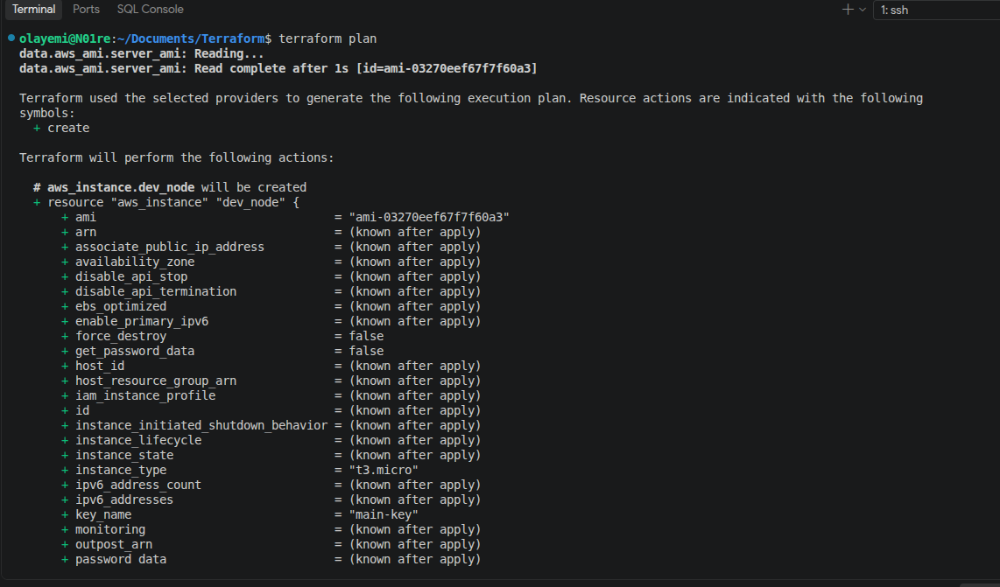

### 2. `terraform apply`

All 9 resources are created, and the instance's public IP is returned as an output.

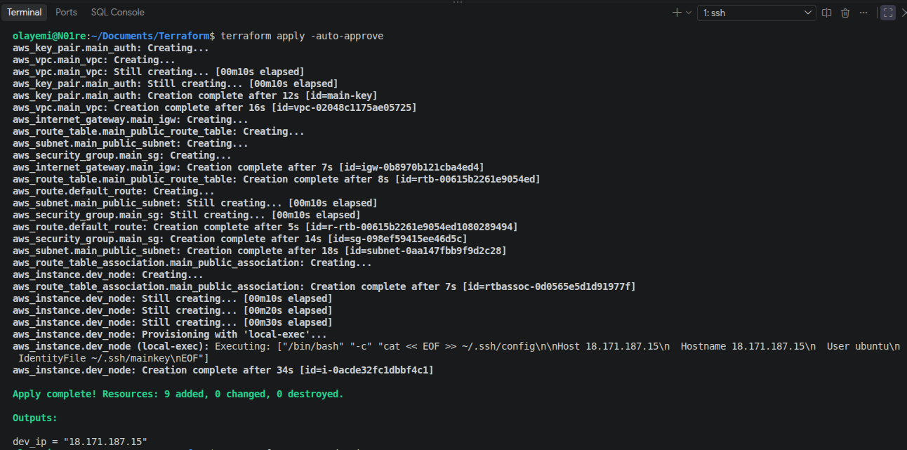

### 3. SSH into the instance

Connecting to the new Ubuntu 24.04 server with the key pair Terraform registered.

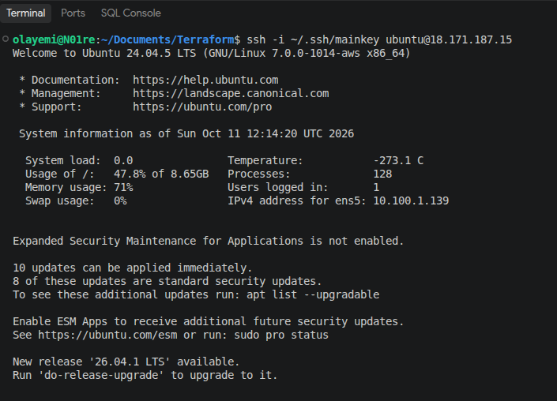

### 4. Docker installed by `user_data`

`cloud-init status` reports `done`, and Docker 29.9.0 runs the `hello-world` container, confirming the bootstrap script worked with no manual setup.

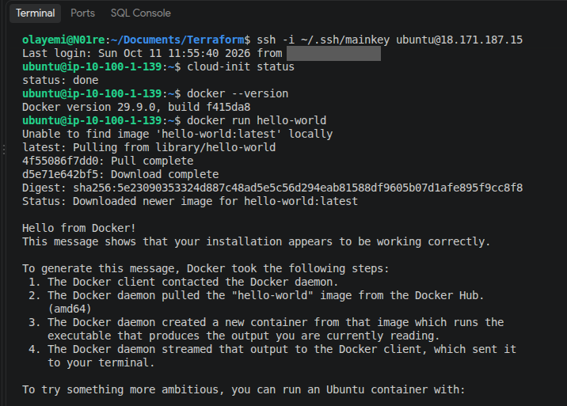

### 5. nginx container serving a web page

A container started by `user_data` serves the nginx welcome page on port 80. `curl` and the browser both reach it from my machine, because the security group opens port 80 to my IP only.

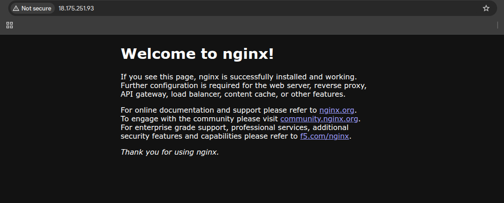

### 6. Resources organised into modules

`terraform state list` shows every resource under `module.network` or `module.compute`, confirming the refactor into two modules applied cleanly.

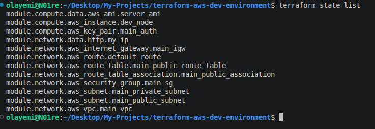

### 7. EC2 instance in the AWS console

`dev-node` is running with 3/3 status checks passed.

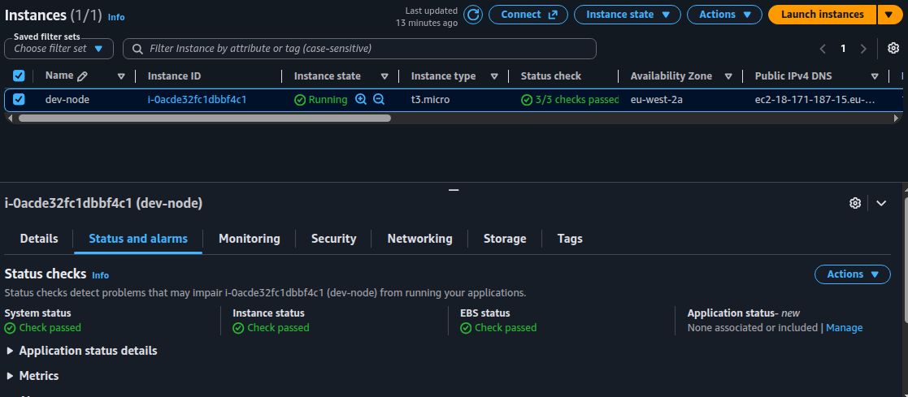

### 8. VPC in the AWS console

The `dev` VPC with DNS resolution and DNS hostnames enabled.

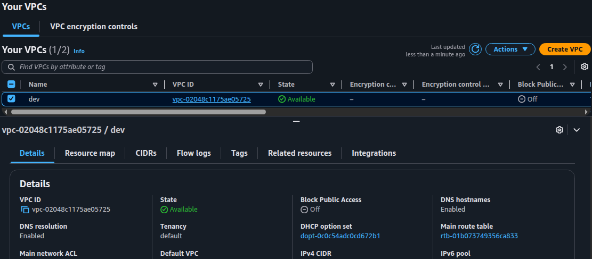

### 9. Public subnet in the AWS console

`dev-public-subnet` (`10.100.1.0/24`) in `eu-west-2a`.

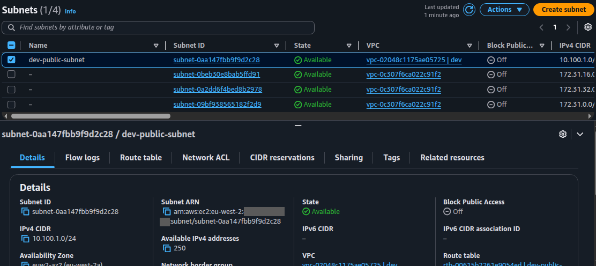

### 10. `terraform destroy`

All 9 resources are removed cleanly, leaving nothing running or billing in the account.

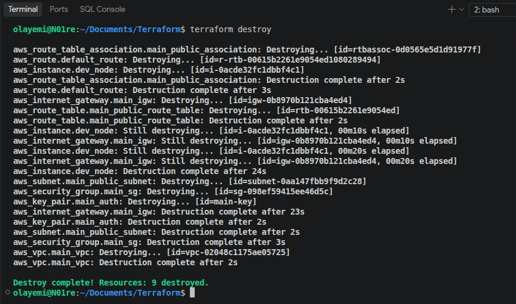

_Screenshots 1 to 10 were taken on the earlier version of the project, before the NAT gateway was added._

### 11. Private test server with no public IP

A test server in the private subnet (`10.100.2.81`) has no public IPv4 address, so it cannot be reached from the internet. The apply output also shows the NAT gateway's public IP (`nat_public_ip`).

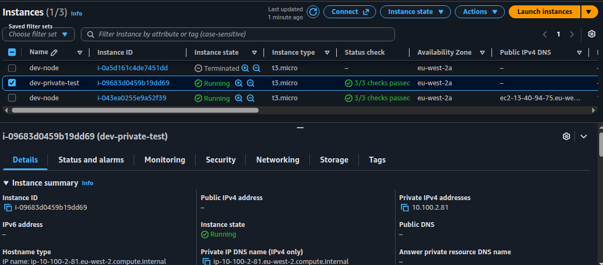

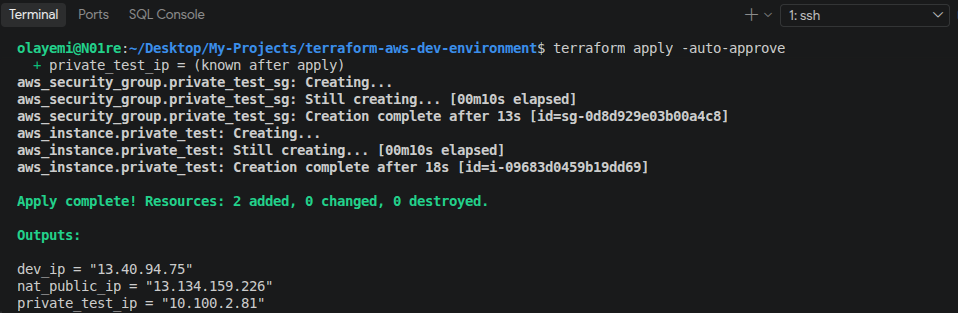

### 12. NAT gateway

`dev-nat` is **Available**, sits in `dev-public-subnet`, and has an Elastic IP as its public address.

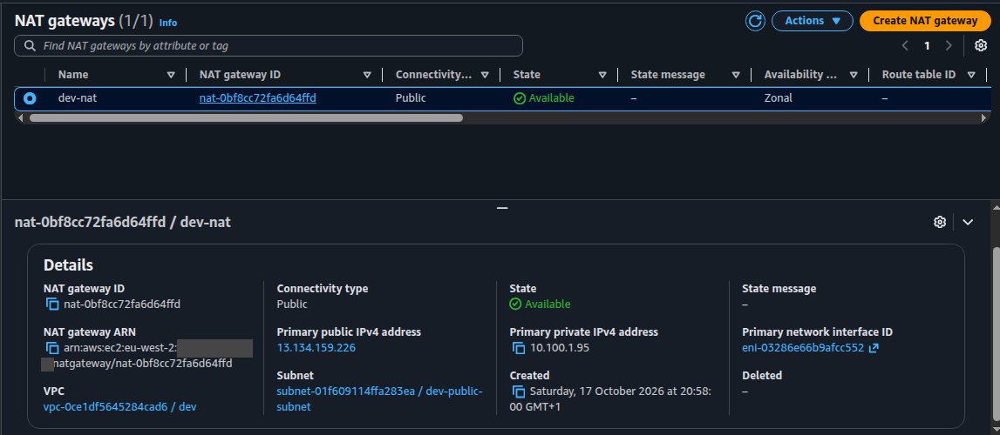

### 13. Private route table

The private route table sends `0.0.0.0/0` to the NAT gateway, and it is associated with `dev-private-subnet`.

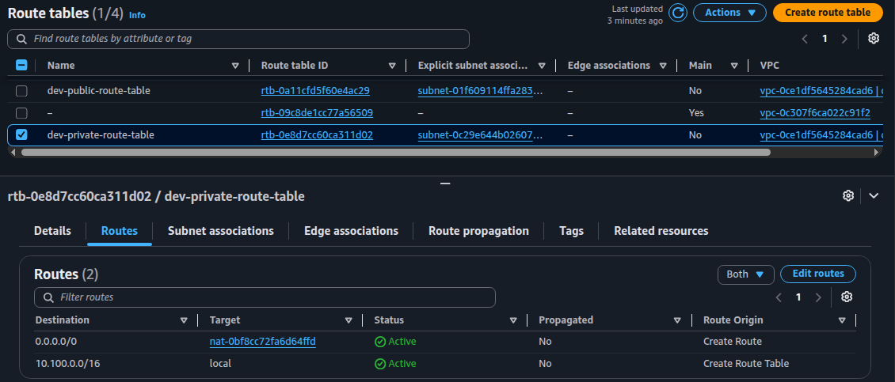

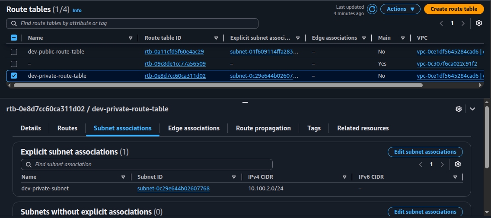

### 14. Outbound internet through the NAT

After SSHing to the private server through the public server (jump host), `curl https://checkip.amazonaws.com` prints `13.134.159.226`, the same address as the `nat_public_ip` output. This shows the private server's outbound traffic leaves through the NAT gateway.

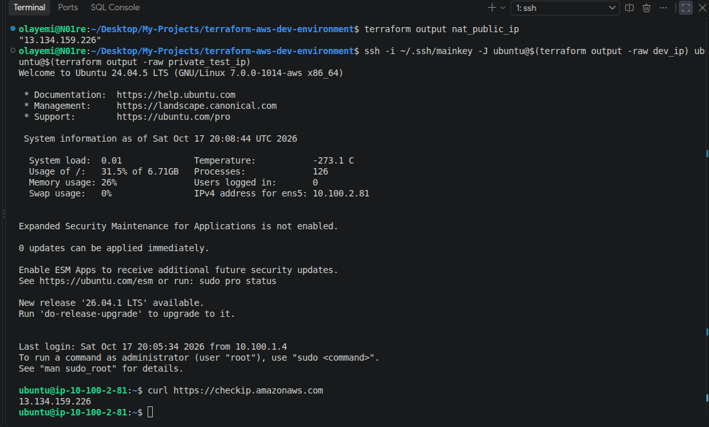

### 15. Cleanup

`terraform destroy` removes everything, including the NAT gateway and Elastic IP, so nothing keeps billing.

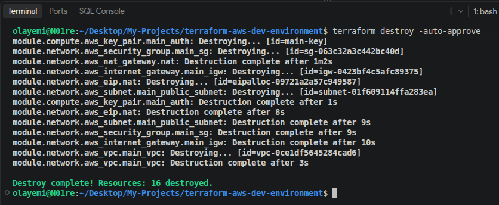

### 16. Remote state backend configured

After adding the `backend "s3"` block, `terraform init -migrate-state` completes successfully, and `.terraform/terraform.tfstate` records the backend type as `s3`. Terraform did not ask to copy any state because the environment had been destroyed, so the local state was empty.

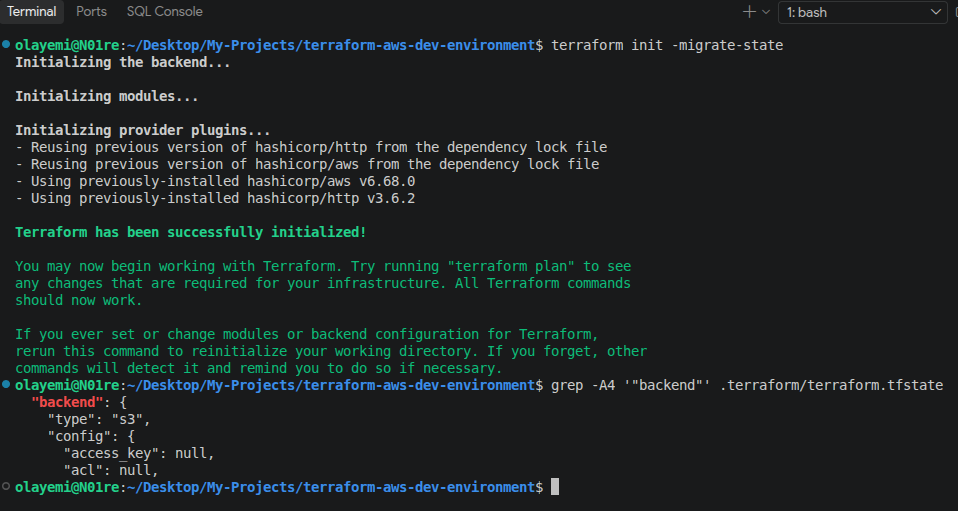

### 17. State and lock objects in the bucket

After the first apply, the bucket holds `terraform.tfstate`, and `terraform.tfstate.tflock` appears while a run holds the lock.

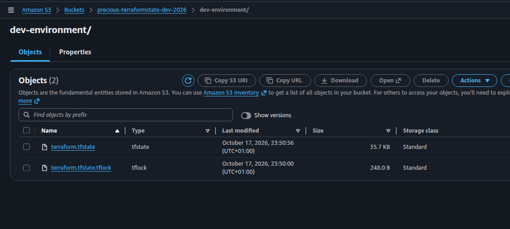

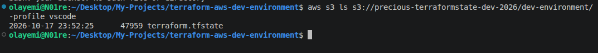

### 18. State locking

With one `terraform apply` waiting at its confirmation prompt, a second `terraform plan` fails with **Error acquiring the state lock** (an S3 `PreconditionFailed`, HTTP 412). The message names the lock ID, the operation and who holds it, so two runs cannot change the same state at once.

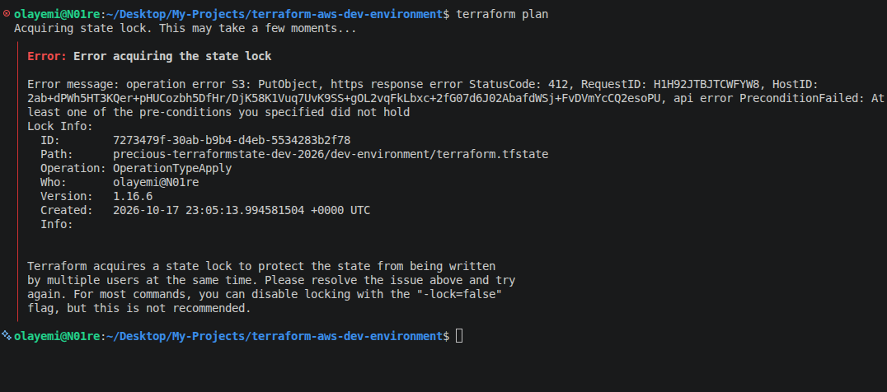

### 19. State bucket: versioning, private, encrypted

Versioning is enabled, so an earlier state file can be recovered. All public access is blocked, and objects are encrypted by default with SSE-S3.

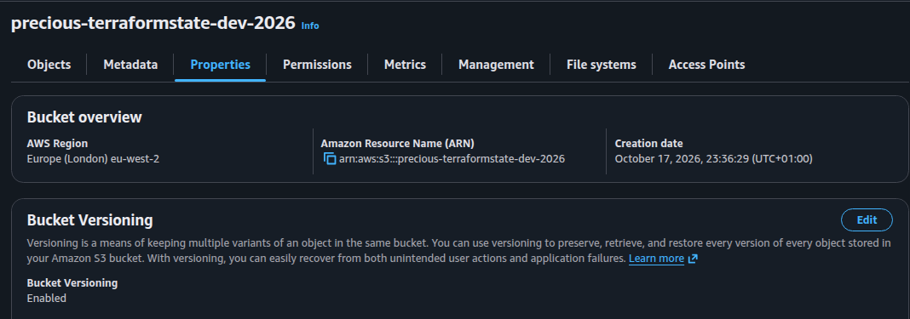

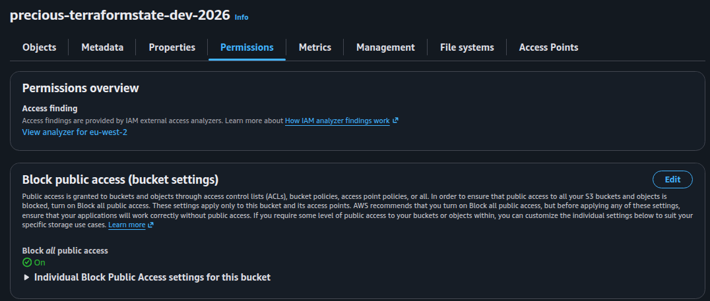

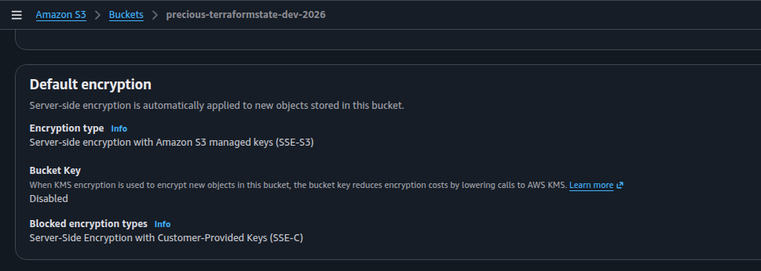

---

## Troubleshooting

Problems I hit while building this, and what fixed them:

| Problem                                           | Cause                                                                                                             | Fix                                                                                                                                                        |
| ------------------------------------------------- | ----------------------------------------------------------------------------------------------------------------- | ---------------------------------------------------------------------------------------------------------------------------------------------------------- |
| `docker: command not found` after SSH             | `user_data` runs in the background after boot, and can fail or not run at all                                     | Run `cloud-init status` and wait for `done`. Read `/var/log/cloud-init-output.log` for the failing command                                                 |
| `user_data` edits have no effect                  | `user_data` only runs on first boot, and the instance is not replaced when it changes                             | Set `user_data_replace_on_change = true`, or run `terraform apply -replace=aws_instance.dev_node`                                                          |
| SSH or VS Code Remote-SSH times out               | The saved IP belonged to an instance that no longer existed (after a destroy or stop/start the public IP changes) | Run `terraform output dev_ip`, confirm the instance is running, and remove stale `Host` entries from `~/.ssh/config`                                       |
| SSH times out even though the instance is running | My public IP changed (new network, VPN or router restart), so the security group no longer matches                | Run `terraform apply` from the network I am connecting from. The rule updates in place                                                                     |
| `Reference to undeclared resource` during `plan`  | Example code used placeholder resource names (`aws_subnet.public`) that did not match the names in my `main.tf`   | Run `grep -n '^resource' main.tf` to list the real names and use those. `terraform validate` catches this in seconds                                       |
| `Error acquiring the state lock`                  | Another Terraform run holds the lock (or a run was interrupted and left the lock behind)                          | Wait for the other run to finish. Only if I am sure no run is active, release it with `terraform force-unlock <lock ID>` using the ID in the error message |
| `permission denied` running `docker`              | Group membership only applies to new login sessions                                                               | Log out and back in                                                                                                                                        |

---

## Security Notes

This is a learning environment, and a few choices are intentionally simple. Before using this pattern for anything real, I would change the following:

- **SSH and the web server are restricted to my current IP.** `dev-sg` allows port 22 and port 80 only from my own public IP (`/32`), and no other ports are open. Terraform looks the IP up on every run, so the rule follows me when it changes, but only when I run `terraform apply`. Running plans from a different network (a VPN, or a CI runner) would use that network's IP instead, so I run `plan` and `apply` locally. Port 22 is still reachable by anyone who shares my IP, for example on a shared ISP address, and key-based login is the second layer of protection.
- **The private subnet is not reachable from the internet.** Servers there have no public IP, and the test server's security group allows SSH only from `dev-sg`, so I reach it through the public server as a jump host. NAT gateways cost money by the hour, so I only keep it running while testing.
- **Credentials stay out of the code.** Authentication uses a local named profile, and the private key never leaves my machine.
- **State and secrets stay out of Git.** `terraform.tfstate` can contain sensitive values, so the `.gitignore` excludes state files, `.terraform/`, `*.tfvars`, keys and `.env` files. `.terraform.lock.hcl` is committed so provider versions stay consistent. State is stored in a private S3 bucket with versioning, encryption and locking, and the local state files are deleted after the move. The bucket is created outside Terraform, so `terraform destroy` never removes it.
- **Screenshots are redacted.** My home IP and AWS account ID are covered.

---

## Skills Demonstrated

Terraform, Infrastructure as Code, Amazon VPC, subnets, route tables, Internet Gateways, Security Groups, EC2, SSH key management, data sources, input variables and outputs, `user_data` bootstrapping, Docker Engine installation on Ubuntu, running a container from `user_data`, least-privilege security group rules, private subnets, NAT gateways and Elastic IPs, SSH jump hosts, Linux package management, `local-exec` provisioners, `templatefile` rendering, SSH config automation, troubleshooting with cloud-init logs, secrets hygiene with `.gitignore`, Terraform remote state in S3, state locking, S3 bucket versioning, encryption and public access blocking

---

## What I Learned

- Terraform's workflow (`init`, `plan`, `apply`, `destroy`) gives a repeatable, reviewable way to build infrastructure compared with clicking through the console.
- Resource references create implicit dependencies, so Terraform orders creation without manual sequencing.
- `user_data` automates server setup at launch, so the instance is ready to run containers with no manual steps, but it only runs once and needs log checking when it fails.
- Data sources are better than hardcoded values for things like AMI IDs that change over time.
- Variables let one codebase work across operating systems.
- State tracks real infrastructure, so it must be protected and kept out of version control.
- Modules let one piece of infrastructure feed another through input variables and outputs, and `${path.module}` keeps file paths working from inside a module.
- A private subnet needs a NAT gateway in a public subnet and a route to it before its servers can reach the internet. Comparing the server's outbound IP with the NAT's Elastic IP proves the route works.
- Remote state in S3 removes the risk of losing a local state file, and locking stops two runs from corrupting it. The bucket has to be created first by hand, because Terraform cannot create the place its own state lives.
- When there is no existing state to copy, `terraform init -migrate-state` completes silently, so I confirmed the backend by reading `.terraform/terraform.tfstate` and by listing the bucket after the first apply.
- Opening only the port an app needs, and only to my own IP, keeps a public web server from being exposed to the whole internet.
- Public IPs change when instances are replaced, so stale SSH config entries are a common cause of connection timeouts.

---

## Next Steps

Done:

- SSH restricted to my current IP, updated automatically by Terraform
- Containerised app (nginx in Docker) started from `user_data`, with only port 80 open and only to my IP
- Refactored into reusable `network` and `compute` modules
- Added a private subnet and NAT gateway, tested outbound access from a private server through a jump host
- Moved state to a remote S3 backend with versioning, encryption and locking, and tested the lock

Still to do:

- Add a GitHub Actions workflow to run `terraform fmt -check` and `terraform validate` on every push
